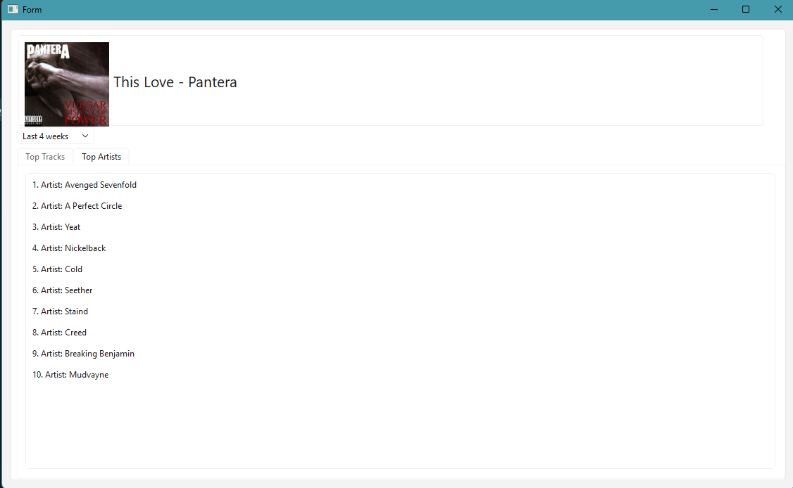

# Spotify Stats Viewer

A desktop app that shows your Spotify listening stats: your top tracks and artists over different time ranges, and a live "now playing" card with album art.

Built with Python, PyQt6 and the Spotify Web API.



## Features

- **Log in with Spotify:** secure OAuth login, so the app never sees your password
- **Top tracks and artists:** your top 10 over the last 4 weeks, 6 months or year
- **Now playing:** shows the song you're listening to with its album cover, updated every 5 seconds
- **Designed in Qt Designer:** the layout lives in `stats.ui`, separate from the logic. Change it how you like. I used pyside6-designer.

## Tech Stack

- **Python 3.12+**
- **PyQt6:** desktop UI
- **Spotipy:** Spotify Web API client (handles OAuth and token refresh)
- **python-dotenv:** loads API keys from a `.env` file
- **Requests:** downloads album art

## Setup

### 1. Create a Spotify developer app
1. Go to the [Spotify Developer Dashboard](https://developer.spotify.com/dashboard) and log in.
2. Click **Create app**.
3. Set the **Redirect URI** to `http://127.0.0.1:8888/callback`.
4. Select **Web API**, then save.
5. Open the app's **Settings** and copy your **Client ID** and **Client Secret**.

### 2. Clone and install
```bash
git clone https://github.com/ameeradas12/Spotify-Stat-Checker.git
cd Spotify-Stats-Viewer
python -m venv .venv
.venv\Scripts\activate
pip install spotipy python-dotenv PyQt6 requests
```

### 3. Add your keys
Create a `.env` file in the project folder:
```
SPOTIPY_CLIENT_ID=your_client_id
SPOTIPY_CLIENT_SECRET=your_client_secret
SPOTIPY_REDIRECT_URI=http://127.0.0.1:8888/callback
```
> Don't commit your `.env` file. It's already listed in `.gitignore`.

### 4. Run it
```bash
python app.py
```
The first time, a browser window opens so you can log in to Spotify and approve access.

## Project Structure

```
├── app.py       # The PyQt window: loads the UI wires up signals, timer
├── main.py      # Spotify API logic: login, top tracks/artists, now playing
├── stats.ui     # UI layout made in Qt Designer
└── .env         # Your API keys (not committed)
```

## Notes

- Spotify's API doesn't provide play counts, so the top lists are ranked by Spotify's own listening calculation.

## Planned Features

- Album art icons in the top tracks list
- Paused indicator on the now playing card
- Recently played tab
- Lifetime stats from Spotify's extended streaming history export
- Progress bar on currently playing song